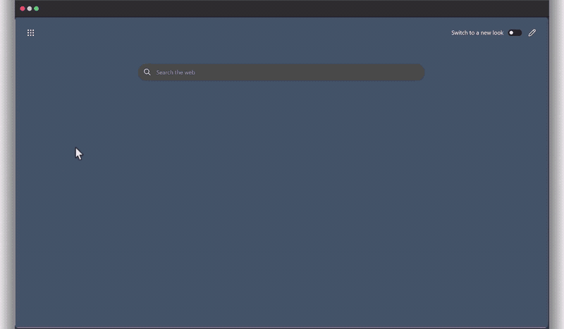
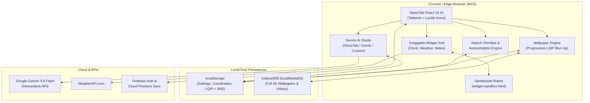

# 🪟 GlassTab — Futuristic Glassmorphic AI New Tab Dashboard

<p align="center">
  <a href="https://aryansrivastava07.github.io/GlassTab/glasstab-extension.zip">
    
  </a>
</p>

<p align="center">
  
  
  
  
  
  
  
</p>

<p align="center">
  <strong>Transform your browser's default blank tab into a sleek, frosted-glass productivity cockpit.</strong><br/>
  Featuring instant 0ms blur-up wallpapers, freeform draggable widgets, smart autocomplete search, and built-in Google Gemini 3.8 Flash AI.
</p>

---

## 🎬 Preview

### Set up your first tab

The skippable quick start lets you organize shortcuts, choose a wallpaper, and set today's focus. Reopen it any time from **Settings > Sync > Dashboard quick start**.

- **Speed Dial folders.** Drag one shortcut onto another, name the folder, and confirm. For keyboard and touch, choose **Organize**, select shortcuts and enter a folder name. Leave the name blank to return them to the main dock.
- **Daily wallpaper.** Under **Settings > Wallpaper**, choose **Daily photo** or **Daily motion**. Daily photo rotates through seven Unsplash landscapes at local midnight. Daily motion renders ocean swells and moving reflections offline, rotating through seven skies and coastlines. Lite mode and reduced motion show a still frame. **My wallpaper** restores your personal background.
- **Today's focus.** Save one priority from quick start or **Quick Notes & Todos > Todos**. It appears on the desktop notes button and resets for the next local day.
- **World clock.** Select the digital face in **Settings > Widgets > Clock** to compare a second time zone.

### Live Animated Preview
<p align="center">
  
</p>

### 📺 Full Video Walkthrough (1080p 60fps)
<video src="assets/glasstab-demo.mp4" controls="controls" width="100%" style="max-height: 520px; border-radius: 12px; box-shadow: 0 10px 30px rgba(0,0,0,0.3);">
  Your browser does not support the video tag. You can view the demo directly at <a href="assets/glasstab-demo.mp4">assets/glasstab-demo.mp4</a>.
</video>

---

## ⚡ 3-Step Instant Install (No Coding Required)

### Updating an unpacked installation

After GitHub Pages is enabled for this repository (Settings → Pages → Source: GitHub Actions), each push to `main` builds and publishes the latest extension files. Open the [GlassTab updater](https://aryansrivastava07.github.io/GlassTab/update/) in Chrome or Edge, select the **exact folder** shown for GlassTab under `chrome://extensions` → Details, and then click Reload on the extension card. The updater checks the downloaded files before writing and leaves browser-stored notes and settings alone. In the extension, open **Settings > Sync > Update to latest version** to start the same updater. Existing installations need one manual visit to the updater to get that button.

The website cannot discover or modify the installed folder without the user's folder selection and write permission. If GitHub Pages has not been enabled, the updater URL will not be available yet.

Want to start using GlassTab right away? No Node.js, Git, or build tools are required:

1. **[📥 Download Extension (.ZIP)](https://aryansrivastava07.github.io/GlassTab/glasstab-extension.zip)**
2. **Extract** the downloaded `.zip` file to any folder on your computer.
3. Open Chrome or Edge and go to `chrome://extensions` (or `edge://extensions`):
   - Turn **ON** **Developer mode** (top-right toggle).
   - Click **Load unpacked** (top-left) and select the extracted folder.
   - Press `Ctrl + T` to open a new tab and click **"Keep changes"**!

> **Edge Users:** Make sure to toggle **"Allow extensions from other stores"** or Developer Mode in `edge://extensions`.

---

## ✨ Key Features

### Google sign-in and AI usage setup

GlassTab requires Google sign-in for chat, web search, attachments, Gemini Live, AI widget generation and image generation. The free **Tools > Create image (free)** action uses a Cloudflare Worker with FLUX.1 Schnell. It accepts text prompts and works independently of the chat provider and chat API key. The Gemini image option remains available for paid generation with reference images.

1. Enable **Google** under Firebase Authentication > Sign-in method for the Firebase project used by GlassTab. For the hosted web app, add its hostname under Authorized domains. Add `localhost` when testing on localhost. The unpacked extension uses the existing Chrome identity OAuth redirect.
2. From the repository root, run `cd ai-worker`, `npx wrangler@4 login`, then `npx wrangler@4 d1 create glasstab-ai-usage`. Copy the returned database ID into `wrangler.toml` as `database_id = "your-id"` under `[[d1_databases]]`. Confirm the Firebase project and web API key match the app. The Worker uses the public Firebase web key for Google token verification.
3. Run `npx wrangler@4 d1 execute glasstab-ai-usage --remote --file=schema.sql`, then `npx wrangler@4 deploy`. Copy the HTTPS Worker URL. A single deployed Worker can serve both local and production clients.
4. In the repository root, set `VITE_AI_WORKER_URL=https://your-worker.workers.dev` in `.env.local`. Restart Vite for local web testing or run `npm run build` and reload the unpacked extension. For updater releases, set the same GitHub Actions repository variable before publishing. AI requests require a reachable usage service.
5. If you use the optional shared Firebase voice function, set `AI_WORKER_URL` in its deployment environment to the same Worker URL and redeploy the function. Personal-key voice, chat and Cloudflare images work without Firebase Functions.

Open **Cloudflare Dashboard > D1 > glasstab-ai-usage > Console** and run `SELECT uid, day, feature, attempts FROM ai_usage ORDER BY day DESC;` to inspect daily actions. Each row counts request attempts for one Firebase user and feature on a UTC day. A voice session counts once. Provider retries belong to the same action. D1 stores aggregate counts without prompts, files or keys. The default free image limit is three images per user per UTC day. Failed image attempts are counted separately and restore a slot. Change `DAILY_IMAGE_LIMIT` in the Worker configuration to adjust it. The Cloudflare account's shared allowance also applies. [Cloudflare Workers AI pricing](https://developers.cloudflare.com/workers-ai/platform/pricing/)

### ⚡ Smart Omnibar & Fast Search
- **Instant Search:** Switch effortlessly between Google, DuckDuckGo, and Bing with automatic query persistence.
- **Real-Time Autocomplete:** Quick URL suggestions and top-destination matching as you type.
- **Address-Bar Autofocus:** Open a tab (`Ctrl + T`) and immediately start typing directly into your dashboard's search bar (customizable toggle in Settings).

### 🧩 Freeform Draggable & Resizable Widgets
- **Live Analog & Digital Clock:** Smooth ticking second hand with reflective glass bezel and customizable styling.
- **Live Weather Widget:** Worldwide city search and automatic geolocation with hourly & daily forecasts, humidity, wind, and temperatures.
- **Notes & Scratchpad:** Fast, floating sticky notes and a markdown vault for daily to-dos and thoughts.
- **Sandboxed Custom Widgets:** Build or paste custom HTML/CSS/JS widgets running safely inside an isolated iframe sandbox (`widget-sandbox.html`).
- **Community Widget Store:** Discover, install, or publish community-created widgets directly to Cloud Firestore.

### 🤖 Gemini 3.8 Flash AI Studio
- **Ultra-Fast Reasoning:** Powered by Google Gemini 3.8 Flash with low latency and live Google Search grounding.
- **Switchable AI Personas:**
  - **GlassTab AI:** A sharp, concise, code-savvy assistant.
  - **Ginnie 🧞‍♂️:** A witty, dramatic genie trapped in your browser with playful banter.
  - **Custom Companion Studio:** Create your own AI companion with customized avatar, name, and personality prompt.
- **Gemini Live voice chat:** Talk streams microphone audio to Google and plays spoken replies inside the popup. Completed turns appear in the current conversation.
- **Text models:** Select Grok, Gemini, OpenAI, Claude, OpenRouter or GroqCloud and supply that provider's API key. Typed chat works independently of voice setup.
- **Code blocks:** Copy code from a reply in one click.

#### Set up voice chat

1. Open [Google AI Studio API Keys](https://aistudio.google.com/apikey). Choose a project and create a Gemini API key. If your existing project is missing, import it under **Dashboard > Projects**. Check your project's Live model access and quota in AI Studio.
2. For a local test, load the unpacked `dist` folder, open the AI Studio popup, sign in with Google and choose **Companion menu > Gemini voice API key**. Paste the key and save. Select **Tools > Talk**, allow microphone access, speak, and select **End** to disconnect. A voice key stays on this device. A previously configured Gemini chat key also works.
3. For shared production access, use the Firebase project configured in `src/firebase.js` (currently `landing-page-efde6`). With a Firebase CLI account that can deploy Functions, run the commands below from the repository root. Enter the shared Gemini key at the secret prompt. Deploying Cloud Functions requires a billing-enabled Firebase project.

   ```sh
   npm ci --prefix functions
   firebase functions:secrets:set GEMINI_API_KEY --project landing-page-efde6
   firebase deploy --only functions:geminiLiveToken --project landing-page-efde6
   ```

   Signed-in users without a personal Gemini key can then select **Talk** immediately. The function issues a single-use, model-restricted token; only the token reaches the client. Replacing or removing the voice key leaves the text provider settings intact. Test shared access in a signed-in browser with neither a voice key nor a Gemini chat key saved.


### 🖼️ 0ms Progressive Blur-Up Wallpapers
- **Frame-0 Rendering:** No blank screens or stutter when opening new tabs.
- **Low-Quality Image Placeholders (LQIP):** Auto-generates an ultra-lightweight (< 3KB) blurred replica stored in `localStorage` that renders instantly while full 4K images or looping videos stream from **IndexedDB**.
- **Offline First:** All wallpaper media is saved directly in browser IndexedDB for instant offline loading.

### 🎨 Deep Glassmorphism & Color Customization
- **Full Visual Suite:** Fine-tune background blur radius, frosted glass opacity, border radiance, and custom RGB accent tints.
- **Independent Module Tuning:** Style Search Bar, Dock, Speed Dials, and Widgets individually.

### 🪶 Performance & Focus
- **Lite Mode for Low-Spec PCs:** 1-click toggle disables heavy blur filters and animations for silky 60 FPS performance on budget laptops.
- **Zen Focus Mode (`Alt + Z`):** Instantly declutter your screen—hides all docks, widgets, and dials for a pure, distraction-free wallpaper & clock view.

### ☁️ Cloud Sync & Privacy
- **100% Usable Offline & Without Sign-in:** All your data remains private and stored in your browser's local storage and IndexedDB.
- **Optional Google Cloud Sync:** Sign in with Google to securely back up wallpapers, custom widgets, notes, and preferences across all your workstations.

---

## ⌨️ Keyboard Shortcuts

| Shortcut | Action |
| :--- | :--- |
| `Ctrl + T` (or `Cmd + T`) | Open GlassTab New Tab |
| `Alt + Z` | Toggle Zen / Focus Mode |
| `/` or `S` | Focus Omnibar Search Bar |
| `Esc` | Clear search / close modals & drawers |
| `Enter` | Search or open top autocomplete result |
| `Arrow Up / Down` | Navigate autocomplete suggestions |

---

## 🛠️ Developer Setup (Build From Source)

To run or modify the project locally:

### Prerequisites
- [Node.js](https://nodejs.org/) (v18.0 or newer)
- npm or pnpm

### 1. Clone the Repository
```bash
git clone https://github.com/Aryansrivastava07/GlassTab.git
cd GlassTab
```

### 2. Install Dependencies
```bash
npm install
```

### 3. Run Development Server (HMR)
```bash
npm run dev
```

### 4. Build Production Extension
```bash
npm run build
```
The production bundle will be generated in `dist/`. Load this folder into `chrome://extensions` via **Load unpacked**.

---

## 🏗️ Architecture & Security Rules

<details>
<summary><b>📐 System Architecture Diagram</b> (Click to expand)</summary>


</details>

<details>
<summary><b>🔒 Firebase Firestore Security Rules</b> (Click to expand)</summary>

Paste these rules into **Firebase Console ➔ Firestore Database ➔ Rules** tab and click **Publish**:

```javascript
rules_version = '2';
service cloud.firestore {
  match /databases/{database}/documents {
    
    // User personal data & cloud sync
    match /users/{userId} {
      allow read, write: if request.auth != null && request.auth.uid == userId;

      // Wallpaper and media binaries
      match /media/{mediaId} {
        allow read, write: if request.auth != null && request.auth.uid == userId;
      }
    }

    // Community Widget Store
    match /widgetStore/{widgetId} {
      // Anyone can browse and load community widgets
      allow read: if true;

      // Signed-in users can publish new widgets
      allow create: if request.auth != null;

      // Creators can update their widgets, or users can increment install count
      allow update: if request.auth != null || 
        request.resource.data.diff(resource.data).affectedKeys().hasOnly(['installs']);

      // Only the author can delete their published widget
      allow delete: if request.auth != null && resource.data.authorUid == request.auth.uid;
    }
  }
}
```
</details>

---

## 📄 License

Distributed under the **MIT License**. See [LICENSE](LICENSE) for details.

<p align="center">
  Built with ❤️ by <a href="https://github.com/Aryansrivastava07">Aryan Srivastava</a>
</p>
